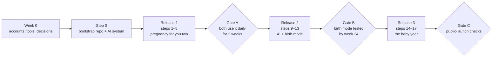

# Kenn — Product and Architecture Plan

Nov 6, 2026 · @d f

> **Provenance.** Mirrored from the "Plan" tab of the Kenn planning document at
> scaffold time (roadmap step 0, 2026-11-07). **This repository copy is the source
> of truth from now on**; the planning document is a historical record. The
> decision log at the end continues here, and `docs/decisions.md` is where each
> session appends its conclusion.

## Verdict

Build Kenn, a Hebrew and English PWA on Next.js + Supabase, keep the medical "truth" as versioned files in git, and ship the shared checklist first. MCP, the AI coach and the gov watcher come after you both use it daily.

Diagrams, scaffold and the AI build workflow: Engineering

Five decisions carry everything else:

1. **Two data layers.** A global knowledge base (KB: tests, vaccines, rights, milestones, each with a source and version) that only humans change. A private household layer (your tasks, notes, measurements, inventory) protected by row-level security.
2. **No end-to-end encryption in v1.** The blueprint suggests local-first E2EE. Push back: with E2EE the server can't run MCP, the coach, reminders or gov-update matching. Use RLS, encryption at rest, MFA and short-lived scoped tokens instead.
3. **"Live" gov updates means a weekly watcher plus your approval.** The MoH and Bituach Leumi pages have no API. Auto-applying scraped medical guidance is the one way this app can actually hurt you.
4. **Multi-tenant schema from day one** (`household_id` + RLS on every table). That is the only scalability work needed now. Don't open it to other families until you've used it for 3 months.
5. **AI never writes to the KB.** AI writes to your data go through the same API as the UI, are logged, and are undoable.

**Not in v1:** feed/sleep/diaper logging (Huckleberry already does it well), offline write sync, public sign-up, native apps.

**The app is not on the critical path.** Test windows (NT at 11+0 to 13+6, glucose at 24–28, Tdap at 27–36, GBS at 36–37) don't wait for infra. If one is close, track it in a shared note today.

## Name: Kenn

**Kenn** (קֵן, "nest") is the pick. In Hebrew it also sounds like כֵּן, "yes". It is one syllable, easy to say in Hebrew, English, Arabic and Russian, and it describes what the app is: the place the whole family's plan lives.

| Name         | Meaning                    | Verdict                                                                     |
| ------------ | -------------------------- | --------------------------------------------------------------------------- |
| **Kenn**     | Nest; sounds like "yes"    | Recommended                                                                 |
| Cub          | Young animal (גור)         | Crowded: CubTrack, Cubtale and Cubby are already baby apps in the App Store |
| Gozal (גוזל) | Chick                      | Good for an Israel-only brand; meaningless abroad                           |
| Tipa (טיפה)  | Drop, a nod to Tipat Halav | Avoid: reads as if run by the MoH                                           |

Working tagline: "The right thing, at the right time."

Before committing: search the Israeli trademark registry and the App Store and Google Play, and check the domain (kenn.app or getkenn.com). I didn't find a baby app named Kenn, but I haven't run a trademark search.

## Who it's for

You two are user zero; every other group below needs one onboarding answer or one content rule, not a different app. These are design hypotheses, so test them on five real families per group before building for them.

| Group                                                 | What they need from Kenn                                                                                                                | Built from                   |
| ----------------------------------------------------- | --------------------------------------------------------------------------------------------------------------------------------------- | ---------------------------- |
| First-time parents (you)                              | The full schedule, partner sync, rights, "what now" every day                                                                           | Core                         |
| Reservist families (מילואים)                          | One parent away for weeks: a solo-parent view, a handoff summary for the returning parent, reservist-family rights in the admin tracker | Handoff + rights KB          |
| IVF families                                          | Dating from the transfer date, earlier reassurance milestones, NIPT and early-scan planning                                             | Onboarding: dating method    |
| Twins, preterm, NICU                                  | Corrected age, NICU notes, extra Tipat Halav visits, twin birth-grant amounts                                                           | Onboarding + `applies_if`    |
| Olim and English speakers                             | Full English, plain explanations of Tipat Halav, Bituach Leumi and health funds                                                         | English locale               |
| Arabic-speaking families                              | Arabic UI, customs module set to theirs or off                                                                                          | Arabic locale (phase 2)      |
| Large and Haredi families                             | Later-child mode (skip what they know), a printable weekly sheet for families without smartphones                                       | Print view                   |
| Single parents, same-sex couples, surrogacy, adoption | Neutral roles, the right leave and rights rules                                                                                         | Neutral roles + rights KB    |
| Grandparents, nannies, daycare                        | Today card, allergies, sleep rules, emergency card, nothing more                                                                        | Scoped roles                 |
| Separated co-parents                                  | Two homes, one child: a shared medicine log and schedule, private notes stay private                                                    | Shared child, two households |
| Expats and parents abroad                             | A country pack (Israel, US, UK, EU) with its schedule, units and emergency numbers                                                      | KB per country               |

## Product shape

v1 is done when you both sign in on your phones, see this week, tick an item, and the other phone shows it within seconds, with a reminder before every window closes.

| Module                    | What it does                                                                                                                                                                   | Phase                 |
| ------------------------- | ------------------------------------------------------------------------------------------------------------------------------------------------------------------------------ | --------------------- |
| Onboarding                | 2-minute wizard: dating method (LMP, ultrasound, IVF transfer), number of babies, first or later child, health fund and tier, language, customs; builds your personal schedule | v1                    |
| Today (היום)              | Week N or baby age, next 3 due items, overdue in red, one fetal/baby card                                                                                                      | v1                    |
| Timeline                  | Pregnancy weeks, then baby months, with every window drawn on it                                                                                                               | v1                    |
| Checklist                 | Tests, vaccines, Tipat Halav, admin and rights, dated from your anchors                                                                                                        | v1                    |
| Calendar feed             | Private ICS link: every window appears in Google or Apple Calendar                                                                                                             | v1                    |
| Safety center             | Emergency card, red flags, safe sleep, shelter, car, recalls (see Safety center)                                                                                               | v1 core, grows by age |
| Things                    | Shopping list: need / ordered / have / borrowed, budget, gift registry, recall checks                                                                                          | v1.5                  |
| Import / export           | Any CSV in (mapped and previewed), everything out as CSV, JSON or a PDF summary                                                                                                | v1.5                  |
| Birth mode                | Hospital bag, 5-1-1 contraction timer, kick counter, "we're going" message to family                                                                                           | v2 (by week 34)       |
| MCP                       | Claude or any MCP client reads your state and updates tasks, notes, inventory                                                                                                  | v2                    |
| Coach                     | Weekly check-in, decision deep-dives, pre-visit prep, voice capture after visits                                                                                               | v2                    |
| Milestones and growth     | CDC 2022 + Israeli scale, corrected age, WHO curves                                                                                                                            | v2 (needed at birth)  |
| Medicine and allergen log | What was given, when, by whom; allergen introductions and reactions                                                                                                            | v2 (at birth)         |
| Check-ins                 | Every 2 weeks for both parents: mood (EPDS-based), sleep, load split                                                                                                           | v2                    |
| Library                   | Debates, approaches, customs, each with an evidence badge                                                                                                                      | v2                    |
| Sharing                   | Family, caregiver handoff, expiring links, gift registry                                                                                                                       | v2                    |
| Documents                 | Results and scans, private storage                                                                                                                                             | v3                    |

## Safety center

Kenn's safety features are fixed, reviewed content and simple tools, never AI-generated advice. Each one unlocks at the age it matters, so the screen never shows twenty warnings at once.

| Feature                  | What it does                                                                                                                                                                    | When         | Source of truth                                 |
| ------------------------ | ------------------------------------------------------------------------------------------------------------------------------------------------------------------------------- | ------------ | ----------------------------------------------- |
| Emergency card           | 101, the delivery room or ER you chose, Poison Information Center, ERAN 1201, pediatrician; baby's weight and allergies. Works offline; printable for the fridge and caregivers | From week 20 | MoH, your own contacts                          |
| Red-flag guide           | Age-based decision cards: fever ≥38.0°C under 3 months means ER now; reduced fetal movement means the delivery room today                                                       | Always       | MoH, AAP                                        |
| Safe-sleep check         | One-time setup checklist, then reminders at each change: stop swaddling at the first signs of rolling, room-sharing review at 6 months                                          | From week 32 | MoH, AAP 2022                                   |
| Shelter readiness (ממ"ד) | A baby go-bag, sleeping in or near the safe room, your area's time to shelter. Links to the official Home Front Command app; Kenn never relays sirens                           | From week 30 | Home Front Command                              |
| Car safety               | Car seat installed by week 36, rear-facing reminders, seat expiry from Things, guided setup of a phone automation that says "check the back seat" when the car disconnects      | From week 30 | Beterem, MoH                                    |
| Recall alerts            | Items in Things are matched against recall notices; a match raises an alert                                                                                                     | Ongoing      | Israeli recall notices, US CPSC, EU Safety Gate |
| Medicine log             | What was given, when and by whom, so two parents never double-dose. No dose calculator: the dose comes from the label or the pharmacist                                         | From birth   | Label, pharmacist                               |
| Allergen log             | Introductions, reactions, "stop and call" guidance for each                                                                                                                     | 4–6 months   | MoH, LEAP                                       |
| Choking and CPR          | Infant CPR course by week 36, a refresher every 3 months, the choking-foods list at solids                                                                                      | Week 30 on   | MoH, Beterem                                    |
| Childproofing            | Room-by-room list unlocked at 4, 6 and 9 months: gates, anchored furniture, button batteries, window guards                                                                     | 4 months on  | Beterem                                         |
| Mental-health check-ins  | EPDS-based every 2 weeks for both parents; a score over threshold shows the support card, never an AI chat                                                                      | Week 26 on   | MoH directive, EPDS                             |
| Caregiver handoff        | A time-limited card: allergies, sleep rules, medicines given today, emergency contacts                                                                                          | From birth   | Your data                                       |

**Medical governance:** before anyone outside your family uses Kenn, a pediatrician and a midwife review the KB. Every item shows its review date, has a "this looks wrong" button, and AI-drafted text never ships without that review.

## Languages

Hebrew and English ship together in v1, both complete: UI, KB content, notifications, the coach and the PDF summary. Each user picks their own language, so one partner can use Hebrew and the other English in the same household.

- **Direction:** the layout mirrors with `dir`, using CSS logical properties only. Directional icons (back arrows, progress) flip; numbers, phone numbers and timers stay LTR inside RTL text.
- **Hebrew gender forms:** Hebrew UI addresses the reader by gender (סמן / סמני). Ask once in onboarding which form the user wants, and support a neutral plural, using ICU `select` messages in next-intl.
- **KB content:** every item holds `he` and `en` text. CI fails if a published item is missing a locale. AI may draft a translation, but only as a PR someone reviews.
- **Formats:** dates as 14/03/2027 or March 14, 2027 per locale; optional Hebrew date beside it; metric by default, with lb/oz and °F available for English users.
- **Coach** answers in the user's language and quotes the KB item in that language.
- **Next:** Arabic (RTL, so the layout already works) before any public launch in Israel, then Russian. Each new locale means translating the KB, not rebuilding the app.

## Stack and architecture

TypeScript end to end, because the schedule engine must compute identical dates in the UI, the API and the MCP server. Python only for the gov watcher, where scraping and diffing are easier.

| Layer         | Choice                                                                                  | Why                                                          |
| ------------- | --------------------------------------------------------------------------------------- | ------------------------------------------------------------ |
| Frontend      | Next.js (App Router) + Tailwind + shadcn/ui, PWA via Serwist                            | Radix primitives support RTL; one repo for UI, API and MCP   |
| Database      | Supabase Postgres, Frankfurt region                                                     | RLS, realtime and backups built in; low latency from Israel  |
| Auth          | Supabase Auth: Google or email magic link, TOTP MFA required                            | No passwords to leak; MFA because this is health data        |
| Partner sync  | Supabase Realtime on household tables                                                   | Yarden ticks, your screen updates                            |
| Files         | Supabase Storage, private bucket, signed URLs                                           | Scans and results never public                               |
| Jobs          | Supabase pg\_cron for reminders; GitHub Actions for the gov watcher                     | No servers to run                                            |
| Notifications | Web Push (VAPID) + Sunday email digest                                                  | iOS push works only after "Add to Home Screen"               |
| MCP           | Remote MCP server (official TypeScript SDK, Streamable HTTP) as a route of the same app | Same auth, same RLS, same engine                             |
| AI            | Claude API, server-side only, prompt caching for the KB                                 | Key never reaches the browser                                |
| Hebrew dates  | @hebcal/core                                                                            | Brit day 8, pidyon haben day 31, Shabbat                     |
| Content       | `/content/*.yaml` in the repo, schema-validated in CI                                   | Git gives review, diff and history for every guidance change |
| Tests         | Vitest (engine), pgTAP (RLS), Playwright (flows)                                        | RLS tests are the security tests                             |

See `docs/diagrams/deployment.mmd` for the deployment diagram (clients, app, Supabase, content pipeline), rendered in `docs/architecture.md`, section "Deployment".

The UI, share pages, MCP and the coach all call one service layer with the user's token, so RLS guards AI exactly as it guards you. Guidance enters only through a merged PR.

SvelteKit is a fine, lighter alternative to Next.js; pick whichever you'll enjoy maintaining. Your gym tracker needs the same auth + MCP skeleton, so build it once as a template.

## Data model

The KB says what should happen and when; household data records what actually happened. A task instance links the two by KB item id and version, so a guidance change never silently rewrites your history.

**KB item (in git, seeded to a read-only table):**

```yaml
id: preg.gbs-swab
version: 2
country: IL
phase: pregnancy
category: test
locales:
  he: { title: 'בדיקת GBS (משטח נרתיקי ופי הטבעת)' }
  en: { title: 'GBS swab (vaginal and rectal)' }
window: { anchor: LMP, start_days: 252, end_days: 265 }
red_flag_days: 266
applies_if: {} # e.g. { fetuses: 1 } or { customs: jewish }
coverage: basket
priority: critical
evidence: guideline
sources:
  - https://me.health.gov.il/parenting/family-planning/healthy-pregnancy/risks-complications/gbs/
valid_from: 2023-12-01
review_by: 2027-03-01
rules: []
```

**Household tables (every row carries `household_id`, every table has RLS):**

| Table                            | Holds                                                                                                                           |
| -------------------------------- | ------------------------------------------------------------------------------------------------------------------------------- |
| `household`, `member`            | You two, roles, notification settings                                                                                           |
| `pregnancy` / `child`            | LMP, ultrasound-corrected EDD, birth date, gestational age at birth (for corrected age), sex, birth type (affects pidyon haben) |
| `task_instance`                  | KB item + version, computed window, status, assignee, `done_by`, `done_at`, note                                                |
| `milestone_obs`                  | Milestone, observed date, observer                                                                                              |
| `measurement`                    | Weight, length, head circumference, date                                                                                        |
| `inventory_item`                 | See Things                                                                                                                      |
| `document`                       | Storage path, type, linked task                                                                                                 |
| `coach_session`, `coach_message` | Summary, decisions, transcript                                                                                                  |
| `share_grant`                    | Grantee or hashed token, scopes, expiry, revoked                                                                                |
| `mcp_client`                     | OAuth client, scopes, last used, revoked                                                                                        |
| `audit_log`                      | Who (user or MCP client), what, before/after, when                                                                              |

**Schedule engine:** a pure function `(kb_items, anchors, today) → instances`. Anchors are LMP, EDD, birth and corrected birth. Rules handle the special cases: the RSV birth-month rule (April–August births get Beyfortus at Tipat Halav), brit on day 8 with postponement, pidyon haben on day 31 only for a firstborn son by vaginal birth, and Shabbat. Instances are materialized when an anchor changes, so reminders are plain SQL queries.

**Making it work for every family:** KB items add `locales` (`he` and `en` text), `country` (`IL` first), and `applies_if` conditions: dating method, number of babies, birth type, health fund and tier, customs, first or later child. The engine skips items whose conditions don't match, so one KB serves everyone. New household tables: `medicine_log`, `allergen_log`, `contact`, `check_in`, `recall_match` and `calendar_feed` (hashed token). A child can be linked to a second household for separated co-parents, with only the shared logs visible to both.

**Also needed from step 1:** `invite` (hashed token, 7-day expiry) and `push_subscription` (one row per device, removed when the browser revokes it).

## Security

The realistic threats are a leaked key, a wrong RLS policy and an AI tricked into acting, not a nation-state. Each gets a specific control.

| Threat                                | Control                                                                                                                                       |
| ------------------------------------- | --------------------------------------------------------------------------------------------------------------------------------------------- |
| Stolen phone or session               | MFA required; 30-day sessions; "sign out everywhere"; PWA lock with device biometrics for the Documents tab                                   |
| RLS bug exposes another household     | RLS on every table, default deny; pgTAP tests that user A can't read household B, run in CI on every PR                                       |
| Leaked service-role or Claude API key | Keys only in Vercel/Supabase/GitHub secrets, never `NEXT_PUBLIC_*`; GitHub secret scanning on; service role used only by the watcher and cron |
| Prompt injection via MCP or coach     | Fetched and shared text is passed as data; AI tools have no delete, no sharing, no outbound messages; writes logged and undoable              |
| Share link leaks                      | Links are scoped, expire (default 30 days), store only a hashed token, and show a view log; no health data on links                           |
| Supply chain                          | Dependabot, lockfile, pinned GitHub Actions, no analytics or ad SDKs                                                                          |
| Web attacks                           | Strict CSP, server-side validation (zod) on every input, rate limits on auth, MCP and coach                                                   |
| Data loss                             | Supabase daily backups plus a weekly `pg_dump` encrypted with `age` and copied to storage you own; restore tested once                        |

**Added before other families join:**

- **Operator access:** as admin you could read every family's data. Encrypt notes, documents and logs per household (keys held in Supabase Vault or a cloud KMS), and log and alert on any service-role read of household tables.
- **Coach data minimization:** send the Claude API only what the session needs; never documents, ID-like data or other members' private notes. Check the API's data-retention terms.
- **Secret URLs** (share links, calendar feeds) are stored hashed, expire, and can be rotated in one tap.
- **Passkeys** as the main sign-in once your auth provider supports them, plus recovery codes.
- **Membership changes:** leaving a household revokes access at once and offers a full export. A removed co-owner gets an email and a 7-day export window; nobody loses their child's history silently.
- **Abuse and pen-testing:** rate limits per account and IP, and an external security review before public launch.

**Minimize:** never store ID numbers (תעודת זהות), bank details or health-fund member numbers. The app doesn't need them.

**If you open it to other families,** Israel's Privacy Protection Law (Amendment 13, in force since August 2025) treats health data as especially sensitive. You'd need a privacy policy, a data-security procedure, export and deletion, and legal advice. That is the real cost of "scalable", not servers.

## Sharing and roles

You two are equal owners; everyone else gets a scoped, revocable grant to specific modules, never the whole household.

| Role                       | Sees                                                                  | Can do                                       | How they get in             |
| -------------------------- | --------------------------------------------------------------------- | -------------------------------------------- | --------------------------- |
| Owner (you, Yarden)        | Everything                                                            | Everything, including shares and MCP clients | Account + MFA               |
| Family (grandparents)      | Today card, milestones, photos you mark shared, inventory "need" list | Claim a gift; comment                        | Invite to their own account |
| Caregiver (nanny, daycare) | Feeding notes, allergens introduced, sleep rules, emergency card      | Add a note                                   | Invite, time-limited        |
| Link viewer                | One scoped page, e.g. the gift registry or the birth announcement     | View; claim a gift without signing in        | Expiring link               |

**Gift registry** is the share that will get used most: the inventory's "need" items as a public list. A claim hides the item from other viewers so you don't get three bottle warmers, and you see who claimed what.

Implementation: one `share_grant` table plus RLS policies that check the grant's scopes. Shared pages are rendered server-side from a narrow view, so a bug in the UI can't expose fields outside the scope.

## MCP server

Expose a remote MCP endpoint (`/mcp`) inside the same app, secured with OAuth 2.1 as the MCP authorization spec requires. Each AI client you connect gets its own token, bound to your household and to the scopes you tick on the consent screen.

| Tool                                  | Does                                           | Scope             |
| ------------------------------------- | ---------------------------------------------- | ----------------- |
| `get_today`                           | Current week or age, due and overdue items     | `read:timeline`   |
| `list_tasks`                          | Filter by phase, status, category, date range  | `read:timeline`   |
| `search_kb`                           | KB items with their sources and versions       | `read:kb`         |
| `get_child_status`                    | Milestones, measurements, allergens introduced | `read:health`     |
| `complete_task` / `reopen_task`       | Status change with a note                      | `write:tasks`     |
| `add_note`                            | Note on a task, appointment or day             | `write:tasks`     |
| `log_measurement`, `record_milestone` | Growth and development entries                 | `write:health`    |
| `upsert_inventory_item`               | Add or update a shopping-list item             | `write:inventory` |

**Guardrails:**

- No delete tool. "Remove" archives the row; the UI shows an undo for 7 days.
- Every write goes to `audit_log` with the client name, and the Today screen shows "Claude completed 2 items" so neither of you is surprised.
- Not exposed at all: sharing, MCP client management, documents, the KB. Those stay owner-only in the UI.
- Tool results label KB and user text as data, so instructions hidden in a note or a fetched page don't become commands.
- One-tap "revoke all AI access" in settings.

Test with MCP Inspector, then add the URL as a custom connector in Claude. The tools call the same service layer as the UI, so RLS applies to AI exactly as it does to you.

Don't hand-write the OAuth server. Use a maintained OAuth 2.1 implementation (your auth provider's, if it supports MCP clients, or a vetted library) and keep Kenn's own code to the consent screen and scope checks.

## AI coach

The coach is a Claude API chat with your household state and the relevant KB slice in context. It reads freely, proposes changes as cards you tap to apply, and never writes on its own.

**Session types:**

1. **Weekly check-in** (Sunday, both of you): what's due in the next 14 days, what's overdue, who takes what.
2. **Decision deep-dive:** sleep arrangement, sleep training, BLW vs purées, using the evidence tables in the Library.
3. **Pre-visit prep:** a question list for the OB, Tipat Halav or pediatrician, saved to the appointment.
4. **Post-visit capture:** you dictate what the nurse said; the coach turns it into notes, measurements and follow-up tasks for you to confirm.

**Context assembly per session:** fixed system rules + the KB items for the current phase (cached with prompt caching, since it changes rarely) + household state (week, open items, last 2 weeks of notes) + summaries of earlier sessions. Each session ends by storing a summary and the decisions you made, which seed the next one.

**Safety rails:**

- Red-flag words (bleeding, reduced movement, fever under 3 months, thoughts of self-harm) trigger a fixed emergency card written by you from MoH guidance: 101, the delivery room, ERAN 1201. That card is static text, not model output.
- Answers cite KB items; anything outside the KB is labelled as general information.
- It is framed as a planning coach, not a doctor; every medical decision ends with "confirm with your doctor or Tipat Halav nurse".

**Cost:** two users with weekly sessions is cheap, but set a monthly spend cap in the Anthropic Console and a per-household token counter before anyone else gets access. Use a smaller model for capture and summaries, a larger one for deep-dives.

## Things (inventory)

The shopping list is importable as of 2026-11-09: **61 items in 9 columns**, UTF-8 with BOM, grouped by 8 categories, Hebrew intact. Its column contract, quirks and test fixtures are in [`plans/things-csv-import.md`](plans/things-csv-import.md); the file itself is household data and stays out of the repository.

Only 4 items have a price: the Cybex stroller at ₪3,800, the Chicco Fit 360 car seat at ₪2,200, the Chicco bath at ₪700 and a changing mat at ₪300. That's ₪7,000 priced, with 57 items still unpriced. 52 are marked mandatory, 9 optional; 57 are wanted before the birth, 4 after; 3 are already bought.

The first export was unusable, and it is worth knowing why, because the importer should detect it: Excel's "Save as CSV" on a Hebrew locale replaced every Hebrew character with a literal `?` byte rather than mis-encoding it, so no decoding could recover the text. Download from Google Sheets as CSV instead.

**Item model:**

| Field                      | Notes                                                             |
| -------------------------- | ----------------------------------------------------------------- |
| category, name, qty, model | From the CSV                                                      |
| price\_ils, url            | Tracking parameters (`gclid`, `gbraid`, `_gl`) stripped on import |
| status                     | need, ordered, have, borrowed, not needed                         |
| source                     | Bought, gift (from whom), borrowed (return to whom)               |
| needed\_by                 | A KB anchor, e.g. the car seat at week 36                         |
| claimed\_by                | For the gift registry                                             |

Linking `needed_by` to the KB turns the list into deadlines: the car seat appears on Today in week 34 because the checklist says "installed by week 36". A budget view shows planned vs spent per category.

**Importing any CSV:** one flow for every type (Things, tasks, measurements, contacts, appointments). Pick the type, map columns (remembered per file layout), preview with errors flagged, then import. Encoding is auto-detected, including Windows-1255, the usual culprit in Hebrew Excel exports. Duplicates are merged by name and category. Everything exports back as CSV or JSON, so nobody is locked in.

**Recall checks:** each item with a brand and model is matched weekly against recall notices; a match flags the item and pushes one alert.

## Gov updates

A weekly job watches the source pages each KB item cites, and any change becomes a pull request you approve. Nothing reaches the app without a human merge.

| Source                                                                                                | What it governs                                      | Check                                                       |
| ----------------------------------------------------------------------------------------------------- | ---------------------------------------------------- | ----------------------------------------------------------- |
| me.health.gov.il (vaccine schedule, GBS, carrier screening, newborn screening, safe sleep, vitamin D) | Medical windows and rules                            | Weekly                                                      |
| btl.gov.il (birth grant, maternity pay, child allowance)                                              | Amounts and eligibility                              | Weekly, plus a forced review every January after indexation |
| kolzchut.org.il                                                                                       | Rights summaries                                     | Monthly                                                     |
| MoH circulars (e.g. 5/2024, the 72-hour assessment)                                                   | Tipat Halav process                                  | Monthly                                                     |
| data.gov.il CKAN API                                                                                  | Datasets where they exist, e.g. Tipat Halav stations | Monthly                                                     |

**Pipeline (GitHub Actions, Python):**

1. Collect every URL from `sources` in `/content`.
2. Fetch, extract the main text (trafilatura), normalize whitespace and dates, hash it.
3. Same hash as last run: stop. Changed: diff against the stored snapshot.
4. Send the diff plus the affected KB items to Claude, which returns which fields may be outdated and a proposed YAML edit, with the changed sentence quoted.
5. Open a PR labelled `guidance-change` with the diff, the proposal and links. You or Yarden review against the source page.
6. On merge, CI validates the schema, bumps each item's `version` and deploys. The app shows "guidance updated" on affected open tasks and keeps completed ones on their old version.

Also: `review_by` dates on every item open an issue when they pass, so items with no page change still get rechecked. Fetch politely: once a week, identified user agent, cached.

## Deploy and scale

One repo, three environments, deploy on merge. Both of you install the PWA from the production URL on your home screens.

| Environment | Runs on                                            | Data           |
| ----------- | -------------------------------------------------- | -------------- |
| Local       | `supabase start` (Docker) + `next dev`             | Seed household |
| Preview     | Vercel preview per PR + a Supabase staging project | Fake household |
| Production  | Vercel + Supabase (Frankfurt), your own domain     | Real           |

**CI on every PR:** typecheck, lint, Vitest for the engine, pgTAP for RLS, KB schema validation, Playwright for sign-in, tick-an-item and partner sync. Database changes only through migrations in git.

**Cost:** near zero at two users on free tiers. Free Supabase projects pause after a week without activity, so move production to a paid plan once real data is in. Check current pricing before you commit.

**Scaling path:** two users to a few hundred families needs no architecture change; Postgres with RLS and serverless functions handle it. Costs grow in AI tokens, so per-household caps come before sign-up opens. Before opening up, the work is legal (privacy, terms, medical disclaimer) and support, not infrastructure.

## UX

Simple means one screen answers "what do we need to do now"; everything else is one tap away. Design for one thumb at 3 a.m. in a dark room.

- **Navigation follows the phase:** four tabs during pregnancy (Today · Checklist · Things · Coach), switching to Today · Baby · Checklist · Coach at birth, with Birth mode taking over the screen when labour starts. Safety is a red button on every screen. Library, Sharing and Settings sit behind the avatar menu.
- **Hebrew first:** `dir="rtl"`, CSS logical properties only (`margin-inline-start`, never `margin-left`), dates as "שבוע 24" and "גיל 3 חודשים", full English chosen per user (see Languages). Fonts: Heebo or Rubik, both with full Hebrew.
- **Every item has one primary action** (סמן כבוצע) and shows its window as a short bar: grey before, green inside, red after.
- **Who did it** shows as a small avatar on each item, which also settles "did you call the health fund?".
- **Evidence badge** on every recommendation (strong / moderate / weak / custom), with the source one tap away.
- **Dark mode by default at night,** large tap targets (48 px), no confirmation dialogs; undo instead.
- **Notifications:** at most one push a day, grouped, plus the Sunday digest. A window opening and a window closing in 3 days are the only push triggers.
- **Beautiful** comes from a small design system set once: one accent colour, warm neutrals, 8-pt spacing, one illustration style for the weekly cards. Settle it before the second screen, not after the tenth.

## Roadmap

A bootstrap step, then seventeen steps in three releases, one Claude Code session each. Kenn is useful to you both after step 5; everything after that is additive.



**Start here this week (things only you can do):**

- [ ] Confirm the current week and ultrasound EDD, and put the next test window in a shared note now.
- [ ] Create a private GitHub repo named `kenn` (empty, no README).
- [ ] Create accounts: Supabase (Frankfurt region), Vercel, and the Anthropic Console with a monthly spend cap (the key is first needed at step 11).
- [ ] Install locally: Node LTS, pnpm, Docker, the Supabase CLI and Claude Code.
- [ ] Decide Next.js (the default) or SvelteKit, and Yarden's role.
- [ ] Re-export the shopping list as CSV UTF-8 and upload it to this project.
- [ ] Run the name checks (trademark, stores, domain) and buy the domain.

**Step 0: bootstrap (the first session).** Create the monorepo skeleton with empty packages, `CLAUDE.md`, the `.claude/` agents and skills, `docs/` (the Plan tab as `docs/plan.md`, the Engineering tab as `docs/architecture.md`, `docs/decisions.md`, `docs/plans/roadmap.md`, `docs/learnings/`), and a CI workflow with lint and typecheck. No app code. This step comes first so every later session already runs inside the plan → review → docs → retro loop.

**Release 1: pregnancy, for you two**

1. Repo, Supabase, auth with MFA, `household` + `member`, RLS and the first pgTAP test.
2. i18n skeleton (Hebrew and English, RTL and LTR, gender forms) and the design-system tokens.
3. KB schema with `locales` and `applies_if`; pregnancy items in both languages; CI validation.
4. Schedule engine: anchors, offsets, Hebrew calendar, special rules; Vitest with known dates.
5. Onboarding wizard, Today and Checklist, realtime sync, production deploy, PWA on both phones.
6. Reminders: Web Push, the Sunday digest and the ICS calendar feed.
7. Safety center v1: offline emergency card, red-flag cards, safe-sleep and shelter checklists, car automation guide.
8. Things: generic CSV import and export, budget, gift registry.

**Release 2: AI and birth (before week 34)**

9. MCP server with read tools and OAuth; connect Claude.
10. MCP write tools, audit log, undo, "revoke all".
11. Coach v1: weekly check-in and voice capture, proposals as tap-to-apply cards.
12. Birth mode: hospital bag, contraction timer, kick counter, "we're going" message.
13. Gov watcher with the PR flow, plus recall matching.

**Release 3: the baby year**

14. Baby phase: vaccines, Tipat Halav, milestones with corrected age, growth curves, medicine and allergen logs, childproofing by age, brit and pidyon haben rules.
15. Sharing: family role, caregiver handoff, expiring links.
16. Check-ins for both parents, the PDF summary for the pediatrician.
17. Documents in private storage.

**Gate before any other family signs up:** clinical review of the KB, privacy policy and legal review, per-household encryption, Arabic, an external security review, and 3 months of you two using it daily.

**Pacing:** alongside a full-time job and studies, plan on about two sessions a week. That puts Release 1 roughly 5 weeks after step 0 and Release 2 about 3 weeks after that. Aim for Release 1 by week 30, Release 2 by week 34 and step 14 before the birth; if the dates don't fit, recalculate from your EDD before starting.

**If you fall behind,** cut Release 1 to steps 0, 1, 3, 4, 5 and the emergency card from step 7. That is the smallest version that still keeps the two of you in sync on every window.

**Every later session starts with the same prompt:**

```text
Kenn, next session. Read CLAUDE.md, docs/plans/roadmap.md, docs/decisions.md and the latest file in docs/learnings/.
Run /implement-step for the next unticked step only: propose the plan, wait for my approval, build, test,
run the reviewer agent, /update-docs, then /retro. End with a conclusion: decided, open, next.
```

## Open decisions

Settle these before step 1; the first one sets the deadline for everything.

- [ ] What week are you in, and what's the ultrasound-corrected EDD? That dates every window and decides how much of steps 1–6 fits before the next test.
- [ ] Next.js or SvelteKit?
- [ ] Is Yarden co-building? A natural split: one of you owns the engine and backend, the other owns the KB content review and UX, and you review each other's PRs.
- [ ] Store medical documents at all, or keep them in the health-fund apps and only link? Not storing them removes the most sensitive data.
- [ ] Ever open it to other families? "No" keeps the legal work at zero; "maybe" only requires keeping the multi-tenant schema, which you're doing anyway.
- [ ] Monthly budget ceiling for hosting plus AI.

* [ ] Name: Kenn, after the trademark, store and domain checks?
* [ ] Who are the first 5 test families outside your own (an IVF family, olim, a reservist family)?
* [ ] Which pediatrician and midwife would review the KB before a public launch?
* [ ] Israel-only first, or design the country pack from day one?

## Decision log

Each planning chat ended with a conclusion here, newest first. **The repo now exists, so [`docs/decisions.md`](decisions.md) is the live log from step 0 onward**; this table is kept as the historical record and the step 0 row is its last entry.

| Date                | Decided                                                                                                                                                                                                                                                                                                                                                                                                                                                                                                                                                                                                                                                                                                                                                                                                                                                                                | Open                                                                                                                                                                                                                                                                                                                                                                                                                                                                                                                                                                    | Next                                                                                                                                   |
| ------------------- | -------------------------------------------------------------------------------------------------------------------------------------------------------------------------------------------------------------------------------------------------------------------------------------------------------------------------------------------------------------------------------------------------------------------------------------------------------------------------------------------------------------------------------------------------------------------------------------------------------------------------------------------------------------------------------------------------------------------------------------------------------------------------------------------------------------------------------------------------------------------------------------- | ----------------------------------------------------------------------------------------------------------------------------------------------------------------------------------------------------------------------------------------------------------------------------------------------------------------------------------------------------------------------------------------------------------------------------------------------------------------------------------------------------------------------------------------------------------------------- | -------------------------------------------------------------------------------------------------------------------------------------- |
| 2026-11-07 (step 0) | Monorepo scaffold green on Node 24 (`pnpm check`: lint, typecheck, format, Vitest, `kb:validate`, `docs:gen`, knip; ruff and pytest for the watcher). 5 agents, 8 skills, 3 hooks, all exercised. TypeScript pinned to 6.0.3 not 7.0.2 — TS 7 ships no compiler API so typescript-eslint cannot load it, and "pin the latest" would have meant no linter (ADR-0002). Supabase CLI v3 adopted, local by default (ADR-0003). Next.js over SvelteKit, settled (ADR-0004). Hard rules change only via an ADR, never a retro (ADR-0001). `docs/plan.md` and `docs/architecture.md` are now the source of truth. `pnpm docs:gen` verifies all 14 diagram embeddings against their `.mmd` source. Supply-chain settings explicit: `minimumReleaseAge: 1440`, `allowBuilds` all-denied, Actions pinned by SHA. `docs-drift.yml`, `deploy.yml` and `watcher.yml` deferred to steps 1, 1 and 13. | Current week and ultrasound EDD, and the Supabase, Vercel and Anthropic accounts — both block step 1. Which OAuth 2.1 authorization server for MCP: Supabase Auth is an identity provider, not an AS with dynamic client registration, so the plan's fallback probably does not apply (step 9). Serwist on Next.js 16, which fails the build on a custom webpack config (step 6 risk). The shopping-list CSV is still unrecoverable — ASCII with 2,148 literal `?` bytes and zero Hebrew characters; needs a Google Sheets CSV download (blocks step 8). Yarden's role. | Step 1: Supabase project, auth with MFA, `household` + `member`, RLS and the first pgTAP test, plus `deploy.yml` and `docs-drift.yml`. |
| 2026-11-06 (review) | Step 0 bootstrap added before step 1; build order became the Roadmap with gates A–C; KB items carry `locales` and `applies_if`; `invite` and `push_subscription` tables added; use a maintained OAuth server for MCP, never hand-written; a session prompt template for every build session.                                                                                                                                                                                                                                                                                                                                                                                                                                                                                                                                                                                           | Same as below                                                                                                                                                                                                                                                                                                                                                                                                                                                                                                                                                           | Week 0 checklist, then step 0 in a new chat                                                                                            |
| 2026-11-06          | Name Kenn. Next.js + Supabase, TypeScript monorepo, Python watcher. KB in git, human-approved. No E2EE in v1. Hebrew + English at launch. Safety center as fixed content. AI instructions, agents and skills live in the repo and improve only through approved retros.                                                                                                                                                                                                                                                                                                                                                                                                                                                                                                                                                                                                                | Current week / EDD; Next.js vs SvelteKit; Yarden's role; trademark check                                                                                                                                                                                                                                                                                                                                                                                                                                                                                                | Step 1: scaffold the repo, auth and RLS                                                                                                |

## Sources

Timings, coverage and rules come from the project's research report, _Pregnancy, Birth and the First Year: An Israeli Evidence-Based Milestone Blueprint_, and the MoH, Bituach Leumi and Kol Zchut pages it cites. Re-check vendor details (Supabase plans, Claude pricing, MCP auth libraries) at build time.

- Similar open-source apps: [Baby Buddy](https://awesome.ecosyste.ms/projects/github.com%2Fbabybuddy%2Fbabybuddy), [Sprout Track](https://chatgate.ai/post/sprout-track), [Contractions](https://www.github.com/jayjun/Contractions)
- Name check, existing "Cub" baby apps: [CubTrack](https://apps.apple.com/app/id6774663394), [Cubtale](https://apps.apple.com/app/id1541460870), [Cubby](https://apps.apple.com/app/id6784482213)
