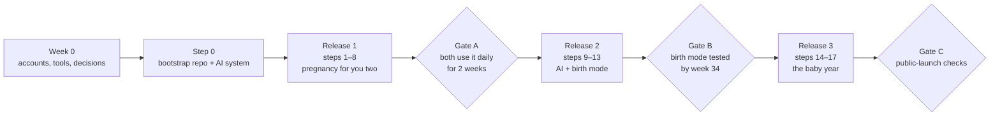

# Kenn roadmap

A bootstrap step, then seventeen steps in three releases, **one Claude Code
session each**. Kenn is useful to both parents after step 5; everything after
that is additive.

Tick a step only when its definition of done is met (`docs/architecture.md`,
section "Definition of done for every roadmap step"). `/update-docs` ticks it.



## Week 0 — only Dor can do these

- [ ] Confirm the current week and the ultrasound-corrected EDD, and put the next
      test window in a shared note **today**. The app is not on the critical path.
- [x] Create a private GitHub repo named `kenn`
- [ ] Create accounts: Supabase (Frankfurt region), Vercel, and the Anthropic
      Console with a monthly spend cap (the key is first needed at step 11)
- [ ] Install locally: Node 24 LTS, pnpm 12, Docker, the Supabase CLI and Claude Code
- [x] Decide Next.js or SvelteKit — **Next.js** (ADR-0004)
- [ ] Decide Yarden's role
- [ ] Re-export the shopping list as **CSV UTF-8** — the current export lost every
      Hebrew character to literal `?` bytes and cannot be recovered by decoding.
      Download from Google Sheets as CSV rather than exporting from Excel.
- [ ] Run the name checks (Israeli trademark registry, App Store, Google Play) and
      buy the domain

## Step 0 — bootstrap

- [x] **Step 0.** Monorepo skeleton, root and per-package `CLAUDE.md`, `.claude/`
      agents, skills, hooks and settings, `docs/` mirror, CI green on the empty
      skeleton. No app code. _(2026-11-07 — `docs/learnings/2026-11-07-step-0-bootstrap.md`)_

## Release 1 — pregnancy, for the two of you

- [ ] **1.** Supabase project, auth with MFA, `household` + `member`, RLS and the
      first pgTAP test. Also: `deploy.yml` and `docs-drift.yml`, which need a
      schema to be meaningful.
- [ ] **2.** i18n skeleton (Hebrew and English, RTL and LTR, gender forms) and the
      design-system tokens. Wire the i18n coverage generator into `docs:gen`.
- [ ] **3.** KB schema with `locales` and `applies_if`; pregnancy items in both
      languages; CI validation. Wire the KB catalog generator into `docs:gen`.
- [ ] **4.** Schedule engine: anchors, offsets, Hebrew calendar, special rules;
      Vitest with known dates, run under a non-UTC timezone.
- [ ] **5.** Onboarding wizard, Today and Checklist, realtime sync, production
      deploy, PWA on both phones. Playwright arrives here; `eslint-config-next`
      too. Start removing entries from `knip.json`'s `ignoreDependencies`.
- [ ] **6.** Reminders: Web Push, the Sunday digest and the ICS calendar feed.
      **Risk:** Serwist integrates through a webpack plugin and Next.js 16 fails
      the build on a custom webpack config. Verify early.
- [ ] **7.** Safety center v1: offline emergency card, red-flag cards, safe-sleep
      and shelter checklists, car automation guide.
- [ ] **8.** Things: generic CSV import and export, budget, gift registry.
      **Blocked on** a working CSV UTF-8 re-export of the shopping list.

### Gate A — both parents use it daily for two weeks

- [ ] Both phones have the PWA installed from production
- [ ] A window has opened, been reminded, and been ticked by each parent
- [ ] No entry left in `knip.json`'s `ignoreDependencies` for a dependency
      nothing imports

## Release 2 — AI and birth (before week 34)

- [ ] **9.** MCP server with read tools and OAuth; connect Claude.
      **Open decision:** which OAuth 2.1 authorization server. Supabase Auth is
      an identity provider, not an AS with dynamic client registration, so the
      plan's fallback probably does not apply. Do not hand-write it.
- [ ] **10.** MCP write tools, audit log, undo, "revoke all".
- [ ] **11.** Coach v1: weekly check-in and voice capture, proposals as
      tap-to-apply cards. Needs the Anthropic key and a spend cap.
- [ ] **12.** Birth mode: hospital bag, contraction timer, kick counter,
      "we're going" message.
- [ ] **13.** Gov watcher with the PR flow, plus recall matching. Adds
      `watcher.yml`.

### Gate B — birth mode tested by week 34

- [ ] A dry run of birth mode on both phones, offline
- [ ] The emergency card works with no network
- [ ] "Revoke all AI access" tested and verified in `audit_log`

## Release 3 — the baby year

- [ ] **14.** Baby phase: vaccines, Tipat Halav, milestones with corrected age,
      growth curves, medicine and allergen logs, childproofing by age, brit and
      pidyon haben rules. **Needed before the birth.**
- [ ] **15.** Sharing: family role, caregiver handoff, expiring links.
- [ ] **16.** Check-ins for both parents, the PDF summary for the pediatrician.
- [ ] **17.** Documents in private storage.

### Gate C — before any other family signs up

- [ ] Clinical review of the KB by a pediatrician and a midwife
- [ ] Privacy policy and legal review (Privacy Protection Law, Amendment 13)
- [ ] Per-household encryption of notes, documents and logs
- [ ] Arabic locale complete
- [ ] External security review and pen test
- [ ] Three months of the two of you using it daily

## Pacing

About two sessions a week alongside a full-time job and studies. That puts
Release 1 roughly five weeks after step 0 and Release 2 about three weeks after
that. Aim for Release 1 by week 30, Release 2 by week 34, and step 14 before the
birth. **Recalculate from the EDD before starting step 1.**

**If you fall behind,** cut Release 1 to steps 0, 1, 3, 4, 5 and the emergency
card from step 7. That is the smallest version that still keeps both parents in
sync on every window.

## The prompt that starts every later session

```text
Kenn, next session. Read CLAUDE.md, docs/plans/roadmap.md, docs/decisions.md and the latest file in docs/learnings/.
Run /implement-step for the next unticked step only: propose the plan, wait for my approval, build, test,
run the reviewer agent, /update-docs, then /retro. End with a conclusion: decided, open, next.
```
