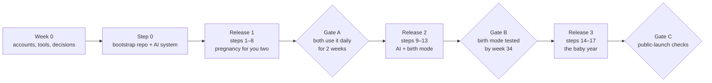

# Kenn roadmap

A bootstrap step, then seventeen steps in three releases, **one Claude Code
session each**. Kenn is useful to both parents after step 5; everything after
that is additive.

`[x]` means done; `[~]` means partly done with the remainder named on the step.
Tick a step only when its definition of done is met (`docs/architecture.md`,
section "Definition of done for every roadmap step"). `/update-docs` ticks it.



## Week 0 — only the account owner can do these

- [ ] Confirm the current week and the ultrasound-corrected EDD, and put the next
      test window in a shared note **today**. The app is not on the critical path.
- [x] Create a private GitHub repo named `kenn`
- [ ] Create accounts: Supabase (Frankfurt region), Vercel, and the Anthropic
      Console with a monthly spend cap (the key is first needed at step 11)
- [ ] Install locally: Node 24 LTS, pnpm 12, Docker, the Supabase CLI and Claude Code
- [x] Decide Next.js or SvelteKit — **Next.js** (ADR-0004)
- [ ] Decide the second parent's role
- [x] Re-export the shopping list as **CSV UTF-8** — done 2026-11-09. UTF-8 with
      BOM, 61 items, 9 columns, Hebrew intact. The structure is recorded in
      [`things-csv-import.md`](things-csv-import.md); the file itself is household
      data and stays out of the repository.
- [ ] Run the name checks (Israeli trademark registry, App Store, Google Play) and
      buy the domain

## Step 0 — bootstrap

- [x] **Step 0.** Monorepo skeleton, root and per-package `CLAUDE.md`, `.claude/`
      agents, skills, hooks and settings, `docs/` mirror, CI green on the empty
      skeleton. No app code. _(2026-11-07 — `docs/learnings/2026-11-07-step-0-bootstrap.md`)_

## Release 1 — pregnancy, for the two of you

- [~] **1.** Supabase project, auth with MFA, `household` + `member`, RLS and the
  first pgTAP test. **Schema half done** (2026-11-09): `household`, `member`
  and `invite`, `is_member()`, `create_household()`, `accept_invite()`, RLS
  on all three, 30 pgTAP assertions, generated types, and a CI job that runs
  them. TOTP enabled in `config.toml`.
  **Still open:** the hosted Supabase project, Google OAuth and real MFA
  enrolment all need the account, and `deploy.yml` needs Vercel. Those are
  what keeps this step unticked.

- [x] **2.** i18n skeleton (Hebrew and English, RTL and LTR, gender forms) and the
      design-system tokens. Wire the i18n coverage generator into `docs:gen`.
      _(2026-11-09 — `/he` and `/en` prerendered with `dir` and `lang` from the
      locale; 28 ICU keys in both locales with Hebrew gender forms; tokens in
      `packages/ui/src/tokens.css` with a WCAG contrast test in both themes and a
      scan that fails on a hard-coded colour or a physical CSS property; the
      coverage generator fails the gate on a key in one locale only, invalid ICU,
      a missing gender branch or a dropped placeholder. 206 tests.)_
- [x] **3.** KB schema with `locales` and `applies_if`; pregnancy items in both
      languages; CI validation. _(2026-11-09 — discriminated union on `kind`, five
      refinements including the ADR-0005 safety veto, 20 schema tests, 21 items
      with every critical window from the research blueprint, KB catalogue
      generated by `pnpm docs:gen`.)_

- [x] **4.** Schedule engine: anchors, offsets, Hebrew calendar, special rules;
      Vitest with known dates, run under a non-UTC timezone. _(2026-11-09 — 59
      engine tests green under `TZ=America/Los_Angeles`; ISO date strings and UTC
      only, no `Date` with a time anywhere in the package.)_

- [x] **5a.** The app against local Supabase: the service layer, the first
      screens, realtime sync and the end-to-end suite. _(2026-11-15 — four
      tables with RLS and a pgTAP file each — `pregnancy`, `household_profile`,
      `task_state`, `audit_log` — taking 30 assertions to 76; thirteen modules
      in `apps/web/lib/services` as the only database callers, with
      `@supabase/ssr` added to the lint boundary beside `@supabase/supabase-js`;
      `lib/today.ts` as the app's only clock, held there by a test that scans
      for any other `Date`; `pnpm kb:build` compiling the YAML into
      `packages/kb/generated/items.json`, because a bundler cannot follow a
      `readdirSync`; sign-in and sign-up, a four-step onboarding wizard, Today,
      the Checklist, the household page with its invite link and the join page,
      replacing the step-2 harness and reading `member.locale` and
      `member.gender_form` through the service layer; a `task_state`
      subscription that calls `router.refresh()`, so the other parent's screen
      re-reads through the service layer rather than trusting the payload; 21
      Playwright tests, `eslint-config-next`, and a CI job that runs the suite
      with the realtime service switched on; and `pnpm check:prerender`, which
      fails if a household route reaches the prerender manifest. The design
      decision is what is **not** there: no `task_instance` table, because a
      window is day offsets from an anchor and the engine derives it at read
      time ([ADR-0008](../adr/0008-derive-windows-store-only-decisions.md)).
      Only the two Serwist entries remain in `knip.json`'s
      `ignoreDependencies`. `docs/learnings/2026-11-15-step-5a-service-layer-and-screens.md`)_

- [ ] **5b.** Production: Google OAuth, real MFA enrolment, `deploy.yml`, the
      first production deploy, and the PWA installed from production on both
      phones. Carries one open decision: **whether email + password survives
      into production.** It is what step 5a signs in with and what the
      Playwright suite needs; Google OAuth may replace it or sit beside it.
      Hosted auth rate limits belong here too, in a `[remotes.production]`
      block — step 5a raised only the local `sign_in_sign_ups`, and the default
      30 per five minutes is the right order of magnitude for two real people.
      Needs the hosted Supabase project and the Vercel account, so it shares its
      blockers with step 1. **Gate A's "both phones have the PWA installed from
      production" cannot be ticked until this lands.**
- [ ] **6.** Reminders: Web Push, the Sunday digest and the ICS calendar feed.
      **Risk:** Serwist integrates through a webpack plugin and Next.js 16 fails
      the build on a custom webpack config. Verify early.
- [ ] **7.** Safety center v1: offline emergency card, red-flag cards, safe-sleep
      and shelter checklists, car automation guide.
- [ ] **8a.** Things, the mechanism: `kind: thing` in the KB schema with the
      safety-veto refinement, the Things hints (baby room, car, lift, budget) as
      new columns on `household_profile` rather than a table of their own —
      step 5a created it with its RLS policy and pgTAP file, so 8a adds columns
      and the assertions that cover them — catalogue filtering in
      `packages/engine`, the picker UI and the budget view. Design:
      [`recommended-lists.md`](recommended-lists.md).
- [ ] **8b.** Things, the content: seed the catalogue from the four real lists —
      **safety overrides first** — then the CSV importer per
      [`things-csv-import.md`](things-csv-import.md), then the gift registry.
      The importer also matches an imported row to a catalogue item, so a family
      arriving with a spreadsheet inherits the guidance. Two gaps the real data
      exposed still need deciding: a sourcing note, and a required flag separate
      from `status`.

### Gate A — both parents use it daily for two weeks

- [ ] Both phones have the PWA installed from production
- [ ] A window has opened, been reminded, and been ticked by each parent
- [ ] No entry left in `knip.json`'s `ignoreDependencies` for a dependency
      nothing imports
- [ ] Every catalogue item marked `unsafe` or `discouraged` cites a named
      authority and a source URL, and none can be added to a list without an
      explicit acknowledgement

## Release 2 — AI and birth (before week 34)

- [ ] **9.** MCP server with read tools and OAuth; connect Claude.
      **Open decision:** which OAuth 2.1 authorization server. Supabase Auth is
      an identity provider, not an AS with dynamic client registration, so the
      plan's fallback probably does not apply. Do not hand-write it.
- [ ] **10.** MCP write tools, audit log, undo, "revoke all".
- [ ] **11.** Coach v1: weekly check-in and voice capture, proposals as
      tap-to-apply cards. Needs the Anthropic key and a spend cap.
- [ ] **12.** Birth mode: hospital bag, contraction timer, kick counter,
      "we're going" message.
- [ ] **13.** Gov watcher with the PR flow, plus recall matching. Adds
      `watcher.yml`. Carries the Class A and Class B source lists from
      [ADR-0006](../adr/0006-source-policy-for-live-recommendation-updates.md):
      authorities may set a safety verdict, editorial guides may only propose a
      catalogue change, and retailers and parent forums are **not scraped**.

### Gate B — birth mode tested by week 34

- [ ] A dry run of birth mode on both phones, offline
- [ ] The emergency card works with no network
- [ ] "Revoke all AI access" tested and verified in `audit_log`

## Release 3 — the baby year

- [ ] **14.** Baby phase: vaccines, Tipat Halav, milestones with corrected age,
      growth curves, medicine and allergen logs, childproofing by age, brit and
      pidyon haben rules. **Needed before the birth.**
- [ ] **15.** Sharing: family role, caregiver handoff, expiring links.
- [ ] **16.** Check-ins for both parents, the PDF summary for the pediatrician.
- [ ] **17.** Documents in private storage.

### Gate C — before any other family signs up

- [ ] Clinical review of the KB by a pediatrician and a midwife
- [ ] Privacy policy and legal review (Privacy Protection Law, Amendment 13)
- [ ] Per-household encryption of notes, documents and logs
- [ ] Arabic locale complete
- [ ] External security review and pen test
- [ ] Three months of the two of you using it daily

## Pacing

About two sessions a week alongside a full-time job and studies. That puts
Release 1 roughly five weeks after step 0 and Release 2 about three weeks after
that. Aim for Release 1 by week 30, Release 2 by week 34, and step 14 before the
birth. **Recalculate from the EDD before starting step 1.**

**If you fall behind,** cut Release 1 to steps 0, 1, 3, 4, 5 and the emergency
card from step 7. That is the smallest version that still keeps both parents in
sync on every window.

## The prompt that starts every later session

```text
Kenn, next session. Read CLAUDE.md, docs/plans/roadmap.md, docs/decisions.md and the latest file in docs/learnings/.
Run /implement-step for the next unticked step only: propose the plan, wait for my approval, build, test,
run the reviewer agent, /update-docs, then /retro. End with a conclusion: decided, open, next.
```
